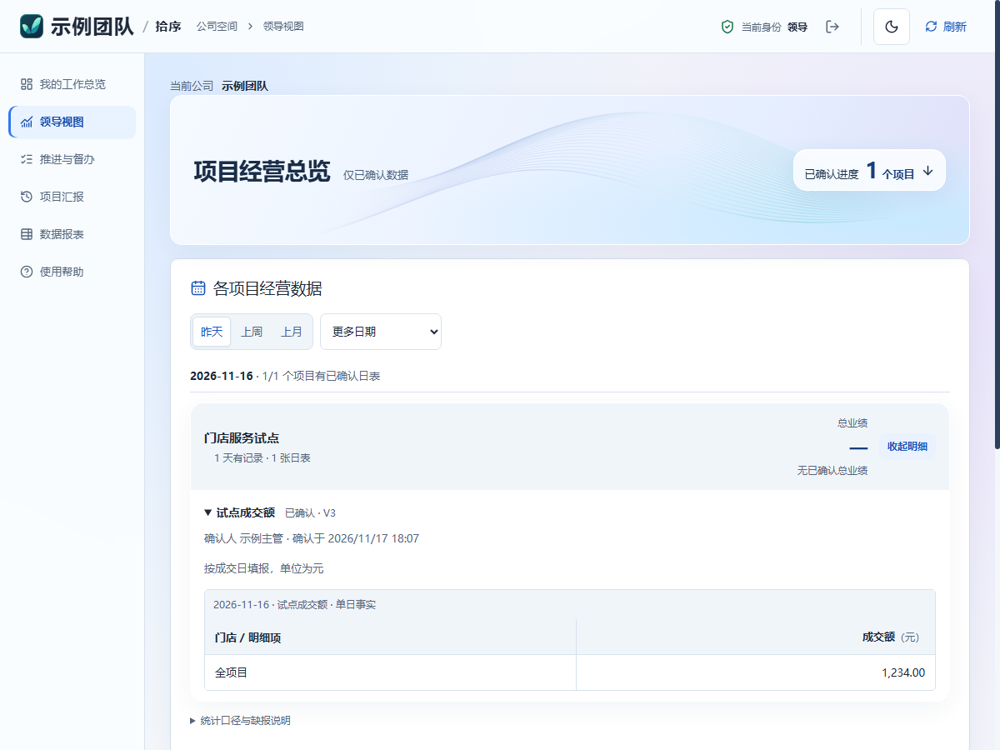

# 拾序工作台模板

拾序把员工填报、主管复核和领导看数放在一个团队空间里。这个版本带网页源码、云端业务函数和一套在本机生成的四角色示例。可以执行真实的保存、提交、退回和确认操作。



员工填报的 1,234 元经示例主管确认后，领导可以在昨天的经营明细里查看金额和确认人。

## 公司层级与项目审批

管理员打开「成员与项目 → 管理组织层级与直属上级」，可在默认的员工、主管、领导三层基础上增减层级、改名和分配成员。在「项目设置 → 逐级审批设置」为每个项目选择确认人和顺序。例如，同一家四层公司的门店日报可以只由店长确认，另一项目则由店长和区域经理依次确认。

员工提交前可以看到接收人，提交后可以看到当前等谁确认。最后一位确认后，数据进入领导汇总。更改审批名单从下一次提交生效。新员工首次进入时可以跟随箭头认识填报入口，也可以从「使用帮助」重看指引。

## 在本机运行

安装 Node.js 22.18 或更高版本，打开模板根目录，运行下面两行。首次安装需要访问 npm 公共依赖库。

```sh
npm ci
npm run demo
```

在浏览器打开 [本地演示](http://127.0.0.1:4173/)。首页有四个身份按钮，点击后即可进入。回到这个地址可以切换身份。终端按 Ctrl+C 停止服务。已经构建过网页时可以用 `npm run demo:serve` 直接启动，修改前端代码后使用 `npm run demo` 重新构建。端口占用时可以设置环境变量 `DEMO_PORT`，然后打开终端显示的地址。

| 身份 | 可以试什么 |
| --- | --- |
| 员工 | 打开「门店服务试点」项目，保存和提交日常汇报，查看本人草稿与退回原因。 |
| 主管 | 核对今天待审的试点成交额，确认或填写原因退回。 |
| 领导 | 打开昨天的经营明细并查看已确认数据；确认今天的记录后，切换到今天查看变化。 |
| 管理员 | 查看和分配成员，建立项目，检查备份与恢复入口。 |

昨日示例成交额为 1,234 元，今日待确认金额为 1,567 元。公司名是「示例团队」，成员登录名是 `staff`、`manager`、`leader`。需要手动重登时，本机四个示例身份的密码都是 `Local-demo-only-01`。管理员使用管理员登录页。

演示服务只监听本机回环地址，使用内存数据库，每次启动都重新生成所有示例业务记录。浏览器在本机保存部分草稿和偏好，清除此站点数据可重置。演示运行所需 OCR 语言包随源码提供，识别在浏览器内执行。

## 用样表走一遍

1. 在本地演示首页下载「三天成交额样表」，选「员工」直接进入数据报表。在「门店服务试点」点「上传报表」，选择下载的文件，点「识别这张表的用途」，核对目标表为「试点成交额」。
2. 查看三天预览，保存草稿，再批量提交。三笔示例金额为 128.90 元、0.00 元和 176.40 元，合计 305.30 元。中间一天特意填了零。样表日期避开已有的两条演示记录。
3. 回演示首页选主管，在「待我确认」复核。再以领导身份查看对应业务日期的已确认数据。

截图也能从「上传报表」进入。识别后先看「优先核对」，对着原图局部就地改。合计差额只能定位到某列时，界面会列出明细与原表合计供复核。管理员可在「项目看板 → 项目设置 → 删除项目」查看项目编号、记录数量与最近业务日期，在「项目回收站」恢复同名误删项目。

## 审阅与复验

```sh
npm test
npm run typecheck
npm run build
```

| 路径 | 用途 |
| --- | --- |
| `cloud/main.tsx`、`cloud/company-root.tsx` | 个人与团队网页入口、登录与会话 |
| `components/`、`app/` | 员工、主管、领导、管理员界面和样式 |
| `cloud/company/` | 公司权限、事务、审批、版本、备份和恢复 |
| `lib/workbench/` | Excel 导入、截图识别、日期/门店匹配、回执、图表和金额口径 |
| `tests/` | 合成业务数据和回归测试 |
| `demo/` | 本机入口、示例初始化、角色登录和网页服务 |
| `dist/web/`、`dist/api/`、`dist/backup/` | 构建后生成的静态网站、主业务函数、定时备份函数 |

审阅时可以沿着一笔成交额从「员工提交」走到「主管退回或确认」，再用领导账号核对统计变化。导入回执的来源定位见 `lib/workbench/operating-receipt-locator.ts`，未经确认的记录可见范围见 `tests/company-review.test.ts` 和 `tests/company-response-privacy.test.ts`。检查测试应同时查看覆盖的场景和断言。

## 使用自己的持久化环境

源码提供腾讯云 CloudBase 适配。以下步骤用于准备独立环境，本模板的验证覆盖本机演示和云函数构建。线上部署、真实账号、多设备同步和定时任务需要在部署方环境验收。

1. 在自己的环境建立四个数据库集合 `shixu_private_v1`、`shixu_backups_v1`、`shixu_company_v1` 和 `shixu_company_backups_v1`，设置数据库权限，让网页仅通过后端函数读写。
2. 执行 `npm run build`。把 `dist/web/` 的内容放在同一 HTTPS 域名的 `/workbench/` 下，将 `/shixu-api/*` 转给 `dist/api/` 的 `index.main`。保留请求路径、方法、来源、Cookie 以及响应中的 Set-Cookie。
3. 在主函数的私有环境变量中填写自己的 `TCB_ENV`、`WB_ORIGIN`（完整 HTTPS 源，没有路径或末尾斜杠）、`WB_SESSION_SECRET` 和 `WB_BOOTSTRAP_HASH`。建议从密码管理器分别生成至少 32 字节的随机签名密钥和一次性启用口令，`WB_BOOTSTRAP_HASH` 使用启用口令 UTF-8 字节的 SHA-256 小写十六进制摘要。首次启用页为 `/workbench/#setup=<一次性启用口令>`，启用成功后用新设的管理员密码进入。函数运行时安装函数包内 package.json 声明的依赖。
4. 在支持 Node.js 的独立备份函数中部署 `dist/backup/`、入口 `index.main`，设置相同 `TCB_ENV` 和独立的 `WB_BACKUP_TIMER_SECRET`（至少 32 个字符）。配置名为 `ShixuBackupHourly` 的定时触发器，以 JSON 字符串传入 `{"token":"<备份触发密钥>"}`。保持该函数仅限定时事件调用。
5. 开一个新的公司空间，用新建的测试成员走完填报、退回、改正、确认、查看和备份恢复，核对权限与账目后再导入业务数据。

`.env.example` 仅列出字段，构建和本地演示均无需云端密钥。角色选择器位于独立的 `demo/`，网页和云函数构建不会包含它。第三方来源和许可见 [第三方说明](THIRD_PARTY.md)。项目自有代码的对外授权尚待所有者确定。
